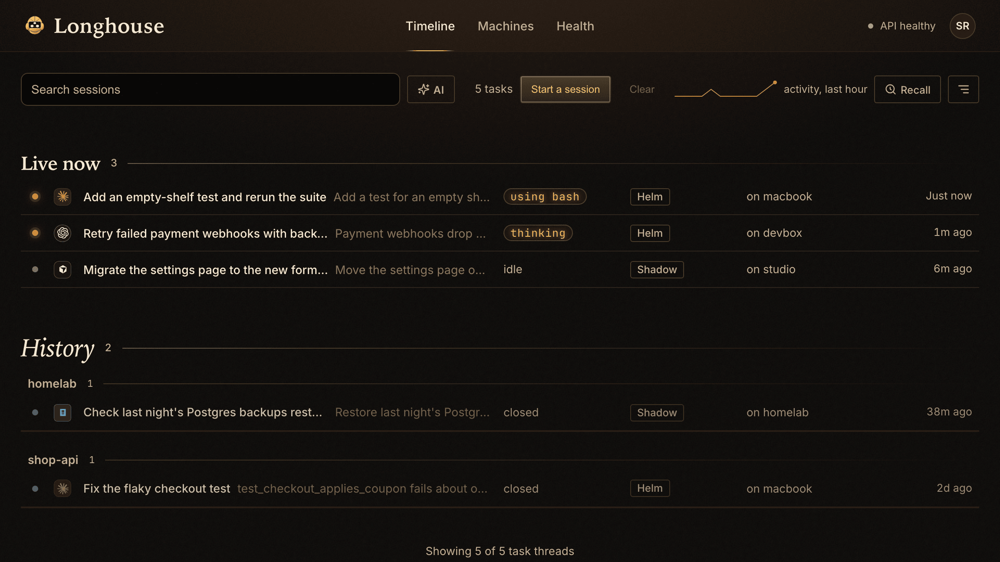

# Longhouse

**Remote control for your coding agents.**

Watch any Claude Code, Codex, Cursor, or OpenCode session live from the web. Search everything they have done. Send your next instruction to a session launched through Longhouse while the agent keeps running in its real terminal on your machine. Apache-2.0 open core.



## What it does

Agent history is scattered across `~/.claude`, terminal scrollback, and one log directory per tool. Longhouse gathers it in one place:

- **Find any past session.** One timeline and full-text search across every provider and machine.
- **Control live work remotely.** Launch a session through Longhouse, then send, interrupt, steer, or resume it later, for the providers that support each operation.
- **Own your history.** The archive is SQLite on your Runtime Host. Provider clients still talk to their providers as usual.

Longhouse does not replace a provider's agent or terminal UI, and you keep your existing provider accounts. A bare provider CLI stays observable through its native archive. A managed launch such as `longhouse claude` keeps the stock terminal and adds a Longhouse control path. The timeline shows only the controls a session can actually perform.

## Parts

| Part | What it is | Runs on |
|---|---|---|
| Machine Agent | Rust engine (`longhouse-engine`) that ships session events and heartbeats | each dev machine |
| Runtime Host | `longhouse-server`: FastAPI API, bundled web UI, SQLite | an always-on box, or your laptop for a trial |

The system map and vocabulary (Shadow, Helm, Console, recall, wall) are in [`ARCHITECTURE.md`](ARCHITECTURE.md). The product thesis is in [`VISION.md`](VISION.md).

## Install

**Shell installer** (macOS, Linux, WSL):

```bash
curl -fsSL https://get.longhouse.ai/install.sh | LONGHOUSE_URL=https://you.longhouse.ai bash
```

It installs the native pair (`longhouse` and `longhouse-engine`), asks what existing history to import, stores the Runtime Host address, opens a browser to approve this machine, and starts the Machine Agent. On macOS it also installs `Longhouse.app` into `/Applications`.

**No Runtime Host yet?** Run one on this machine as a trial. It serves `http://127.0.0.1:8080` and stops when the machine does.

```bash
curl -LsSf https://astral.sh/uv/install.sh | sh   # skip if you already have uv
uv tool install longhouse                          # installs longhouse-server
longhouse-server onboard                           # starts it, installs the Machine Agent, asks what to import
```

### What gets imported

Old transcripts can hold code and secrets from any project you ever ran an agent in. A new machine therefore imports only sessions that start from now on, unless you choose otherwise. The installer asks, and falls back to "from now on" without a terminal. `LONGHOUSE_IMPORT_SCOPE=now|all|2026-09-01` answers it non-interactively. Machines that were already shipping before scopes existed keep shipping everything.

```bash
longhouse machine scope                        # current scope and what it leaves out
longhouse machine scope --project ~/git/app    # also import one project's full history
longhouse machine scope --since all            # everything on this computer
```

Sessions outside the scope are not uploaded. Widening the scope backfills what became eligible. Narrowing it stops further imports but does not recall what was already uploaded or queued.

### Uninstall

```bash
longhouse uninstall --dry-run   # show what would be removed
longhouse uninstall             # revoke this machine's token, stop the service, remove hooks and binaries
                                # (--purge also deletes ~/.longhouse)
```

`longhouse auth --clear` alone revokes the device token and deletes the stored credentials. Sessions already uploaded stay in the Runtime Host archive until you delete them there. To cut off a machine you cannot reach, revoke it under Settings, Devices on the Runtime Host.

## First session

```bash
longhouse claude       # managed Claude Code session
longhouse codex        # managed Codex app-server session
longhouse opencode     # managed OpenCode server session
longhouse cursor       # managed Cursor PTY session
longhouse pi           # managed Pi TUI session
longhouse omp          # managed Oh My Pi TUI session
longhouse antigravity  # managed Antigravity hook session
```

Managed sessions keep the provider's native client and identity and add a session-scoped control path. Bare provider sessions stay Shadow: searchable and observable, not controlled. Console sends a turn to a connected machine without a terminal.

What each provider supports is declared in [`schemas/managed_providers.yml`](schemas/managed_providers.yml) and shown in the product's provider view. This README does not repeat it.

The web UI is at `http://localhost:8080` for a local Runtime Host. Server-side commands use `longhouse-server`:

```bash
longhouse-server status --json
longhouse-server recall "that auth refresh bug from last week"
longhouse-server tail <session-id>
```

## Self-host on an always-on box

A laptop Runtime Host stops when the laptop sleeps. For durability, run it on a VPS, homelab, or Mac mini and point your dev machines at it. Hosted instances (we run the Runtime Host) are invite-only for now.

On the always-on box:

```bash
curl -LsSf https://astral.sh/uv/install.sh | sh   # skip if you already have uv
uv tool install longhouse

export LONGHOUSE_PASSWORD_HASH="$(longhouse-server hash-password)"   # prompts for a password
export JWT_SECRET=$(openssl rand -hex 32)
export INTERNAL_API_SECRET=$(openssl rand -hex 32)

longhouse-server serve --host 0.0.0.0 --domain longhouse.example.com
```

On each dev machine:

```bash
curl -fsSL https://get.longhouse.ai/install.sh | bash   # asks what history to import
longhouse auth --url https://longhouse.example.com
longhouse machine repair --repair-service
```

Binding beyond localhost without auth is refused: `longhouse-server serve` exits and says what to set. The three exports above are the whole requirement. If a trusted reverse proxy already authenticates requests, pass `--allow-public-no-auth`. For TLS, put Caddy in front (`reverse_proxy 127.0.0.1:8080` is the whole config).

### Over Tailscale (no https)

If the box and your machines share a tailnet, skip the domain and proxy. Native clients, the macOS app, and the iPhone app accept plain `http://` to a Tailscale address (`100.x.y.z`, an `fd7a:115c:a1e0::` address, or a `*.ts.net` name).

```bash
longhouse-server serve --host 0.0.0.0                  # on the box; it prints its Tailscale address
longhouse auth --url http://100.x.y.z:8080             # on each dev machine (or http://my-box.your-tailnet.ts.net:8080)
longhouse machine repair --repair-service
```

Other plain `http://` is refused. A LAN address (`192.168.x`, `10.x`, `172.16-31.x`, `*.local`) works only after you opt in with `longhouse auth --url http://192.168.1.20:8080 --allow-insecure-http` or `LONGHOUSE_ALLOW_INSECURE_HTTP=1`; the opt-in is stored with the address and warns on every use. A public address needs `https://`.

## Repair

```bash
curl -fsSL https://get.longhouse.ai/install.sh | bash   # install or upgrade the native pair
longhouse local-health --json                           # diagnose
longhouse machine repair                                # restart a configured machine
longhouse machine repair --repair-service               # install or repair its native service
```

`longhouse --help` lists the device commands and `longhouse-server --help` the Runtime Host ones.

## Status

Pre-release and under active development. Providers with archive and managed control paths: Claude Code, Codex, Cursor, OpenCode, Antigravity, Pi Agent, and OMP. The iOS client (`ios/`) handles APNs push when a session needs you; the beta is on TestFlight: <https://testflight.apple.com/join/CmEd5kY7>. Release process: [`RELEASE.md`](RELEASE.md).

Built by [David W. Rose](https://drose.io/) ([cipher982](https://github.com/cipher982)). Apache-2.0. See [`EDITIONS.md`](EDITIONS.md) for the open-core boundary, [`SECURITY.md`](SECURITY.md) to report a vulnerability, and [`TRADEMARKS.md`](TRADEMARKS.md) for name use.

## Contributing

```bash
git clone https://github.com/cipher982/longhouse.git
cd longhouse
make dev    # local web UI with hot reload against your linked Runtime Host
make test   # backend unit tests
```

[`CONTRIBUTING.md`](CONTRIBUTING.md) covers setup, test tiers, codegen, and the code map. Issues: <https://github.com/cipher982/longhouse/issues>

<!-- readme-test: verifies install from source and health endpoint -->
```readme-test
{
  "name": "longhouse-serve-health",
  "mode": "smoke",
  "workdir": ".",
  "timeout": 600,
  "env": {
    "AUTH_DISABLED": "1",
    "SKIP_DEMO_SEED": "1"
  },
  "steps": [
    "bun install --frozen-lockfile --silent",
    "(cd web && bun run build)",
    "python3 scripts/build/generate_build_identity.py",
    "uv venv .tmp-readme-serve-venv --python 3.12 -q",
    ". .tmp-readme-serve-venv/bin/activate",
    "uv sync --frozen --active --no-dev --project server --quiet",
    "scripts/qa/readme-serve-health-smoke.sh"
  ],
  "cleanup": [
    "rm -rf .tmp-readme-serve-venv"
  ]
}
```

<!-- onboarding-contract:start -->
```json
{
  "workdir": "/tmp/longhouse-onboarding",
  "steps": [
    "cd {{WORKDIR}}/web && bun install --silent && bun run build",
    "cd {{WORKDIR}} && python3 scripts/build/generate_build_identity.py",
    "cd {{WORKDIR}}/server && uv sync",
    "cd {{WORKDIR}}/server && HOME={{WORKDIR}}/.qa-home LLM_DISABLED=1 uv run longhouse-server serve --host 127.0.0.1 --port 8080 --daemon",
    "sleep 5",
    "python3 -c 'import json,urllib.request; p=json.load(urllib.request.urlopen(\"http://127.0.0.1:8080/api/health\")); assert p.get(\"status\") == \"healthy\", p'",
    "cd {{WORKDIR}}/e2e && bun install --silent && PLAYWRIGHT_BASE_URL=http://127.0.0.1:8080 bunx playwright test --config playwright.onboarding.config.js --project onboarding-chromium"
  ],
  "cleanup": [
    "cd {{WORKDIR}}/server && HOME={{WORKDIR}}/.qa-home uv run longhouse-server serve --stop || true",
    "rm -rf {{WORKDIR}}/.qa-home"
  ],
  "primary_route": "/timeline",
  "cta_buttons": [
    {
      "label": "Machines",
      "selector": "button:has-text(\"Machines\")"
    }
  ]
}
```
<!-- onboarding-contract:end -->
